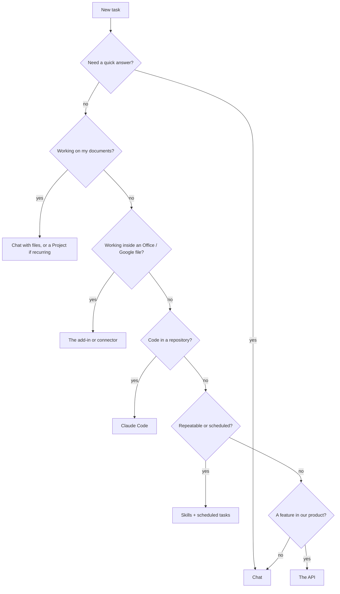

# M1.1 — The Claude ecosystem: surfaces, plans and where work happens

| Status | Audience | Hours | Prerequisite |
|---|---|---|---|
| CORE | All clusters | 1 | None |

**Objective:** name every Claude surface the organisation uses, know which features **your own seat**
includes, and route a task to the right surface instead of defaulting to the chat box.

> Most wasted effort with Claude is a routing problem, not a prompting problem. An engineer who pastes
> 40 files into chat and asks for a refactor has picked the wrong tool before writing the first word.

---

## TL;DR

- Claude is a **family of surfaces**, not one chat box. The surfaces are the Claude app (web, desktop,
  mobile), Claude Code, Claude in Chrome, the Office add-ins, the Google Workspace connectors, Claude Tag
  in Slack, and the Developer Platform (API, Console, Agent SDK).
- **In chat you check an answer. In an agentic session you check actions.** Agentic sessions (documented
  as "Cowork") work on files, connectors, a browser and schedules on your behalf, so you review what Claude
  *did*, not just what it *said*.
- **Plans gate features.** Individual plans are Free, Pro, Max and Ultra. Organisational plans are Team
  (Standard/Premium seats) and Enterprise. **Check your own settings.** A colleague's screen is not
  evidence of what your seat has.
- Usage is metered by a **5-hour window** and a **weekly limit**. Some plans can buy **usage credits** to
  keep working past those limits.
- Use Claude in **four modes**: chatbot → productivity assistant → engineering partner → agentic tool.
  Each mode trades more autonomy for more review responsibility.
- **Routing rules:** quick answer → chat · your documents → chat with files or a Project · inside an
  Office/Google file → the add-in or connector · code in a repository → **Claude Code** · repeatable or
  scheduled work → Skills and scheduled tasks · a product feature → **the API**.
- The classic failure is **doing repository work by pasting code into chat.**
- Authoritative help: `support.claude.com` (apps), `code.claude.com/docs` (Claude Code),
  `platform.claude.com/docs` (API), plus release notes and your internal champions channel.

---

## Concepts

### 1. The Claude product family

| Surface | What it is | Tag | Surface label |
|---|---|---|---|
| **Claude app** | Web (claude.ai), desktop (macOS, Windows, Linux), iOS, Android | GA; Linux desktop BETA | [app] |
| **Claude Code** | Agentic coding: terminal CLI, VS Code extension (also runs in Cursor), JetBrains plugin, desktop app **Code tab**, Claude Code on the web, mobile **Code tab** | CLI GA; JetBrains BETA | [code] |
| **Claude in Chrome** | Browser-extension side panel that reads, clicks and navigates in your signed-in browser | PLAN | [app] |
| **Claude for Microsoft 365** | Excel, PowerPoint and Word add-ins; Outlook add-in; cross-app context (owner-enabled) | PLAN; Outlook BETA | [app] |
| **Google Workspace** | Gmail, Calendar and Drive connectors, plus the Docs, Sheets and Slides live-editing connectors | GA | [app] |
| **Claude Tag in Slack** | Claude as a participant in Slack channels and threads | BETA; Team & Enterprise | [app] |
| **Developer Platform** | API, Console, Agent SDK. Named here, taught at the Advanced and Expert levels | GA | [api] |
| *Named, out of scope* | Claude Science (BETA), Claude Security (BETA, Enterprise), Dispatch, Duet | — | — |

> **Syllabus says:** Desktop app GA on macOS and Windows, Linux BETA.
> **Current (verified 2026-11-14, support.claude.com):** the docs label only Linux as beta. Consistent.

> **Syllabus says:** Claude in Chrome is `PLAN: Pro and above; Enterprise when an admin enables it`.
> **Current (verified 2026-11-14, support.claude.com Chrome admin controls):** available on **all paid plans**
> (Pro, Max, Ultra, Team, Enterprise). On Team and Enterprise it is on by default unless an Owner disables
> it (it is off under HIPAA configurations).

> **Syllabus says:** Excel and PowerPoint add-ins `PLAN: Pro+`; Word and Outlook add-ins BETA.
> **Current (verified 2026-11-14, claude.com/docs office-agents):** Excel, PowerPoint **and Word** are GA on
> Pro/Max/Team/Enterprise. **Outlook is still beta.**

> **Syllabus says:** Claude Tag (BETA; Team and Enterprise) replaced "Claude in Slack" in August 2026.
> **Current (verified 2026-11-14, claude.com/docs claude-tag):** public beta, Team and Enterprise. It replaces
> the earlier Slack app **in place** (same `@Claude` app, no data migrates). The legacy app stopped
> answering in paired workspaces on **5 Oct 2026**. The official docs give no August date.

> **Syllabus says:** Duet is a preview, not available on Team or Enterprise.
> **Current (verified 2026-11-14):** now **"Claude Duet"**, a waitlisted research preview (US only;
> Pro/Max/Ultra), announced 21 Oct 2026. Still out of scope for training.

**How the surfaces relate.** They share the same model family and, where it applies, the same account,
Projects, memory and connectors. They differ in **where Claude can act**:

```
              read/answer only ◀──────────────────────────────▶ acts on systems
 Chat ── Chat+files/Project ── Office/Google add-ins ── Cowork ── Chrome ── Claude Code ── API (your product)
 [app]          [app]                 [app]              [app]     [app]      [code]         [api]
```

### 2. Chat versus agentic work sessions

| | Plain chat | Agentic session ("Cowork") |
|---|---|---|
| What happens | The answer arrives in the conversation and **nothing else changes** | Claude works on **local files, connectors, a browser and scheduled tasks** on your behalf |
| Plans | All | **Paid plans** |
| Where | Every app surface | Desktop GA; web and mobile (see callout) |
| What you review | **The answer**: is it right? | **The actions**: what did it read, write, send, delete? |
| Undo | Ignore the answer | Depends on the action. A sent email can't be unsent |

> **Syllabus says:** Cowork is on paid plans; desktop GA, web and mobile BETA.
> **Current (verified 2026-11-14, support.claude.com "Get started with Cowork"):** paid plans confirmed.
> On desktop only Linux is beta. Web and mobile carry **no beta label on Pro/Max/Ultra**; they are beta on
> **Team**, and on Enterprise they are available when an owner enables them. The approval modes appear as
> Manually approve / Automatically approve / Skip all approvals (M4.1 covers these).

**Why the distinction matters for review.** In chat, a wrong answer costs you the time to notice it. In an
agentic session, a wrong *action* has already happened by the time you notice. The review skill shifts:
- from **reading output** to **reading the action log** (tool calls, files touched, messages sent);
- from **after the fact** to **before the fact** (approval prompts, scoped permissions);
- from **"is this true?"** to **"did it do only what I asked?"**

### 3. Plans and entitlements

| Family | Plans | Who buys |
|---|---|---|
| Individual | **Free, Pro, Max, Ultra** | A person |
| Organisational | **Team** (Standard and Premium seats), **Enterprise** | The organisation, with admin controls |

**What is gated (all PLAN): examples.** These change often. Learn the *pattern*, and check your settings for the facts.

| Feature | Gate (syllabus) | Why it's gated |
|---|---|---|
| Claude Code | Not on Free | Compute-heavy agentic usage |
| Research | Pro and above | Long multi-search runs |
| Claude in Chrome | Paid plans (see callout above) | Acts in your browser |
| Project **sharing** | Team and Enterprise | Needs an organisation to share within |
| Memory | Owner-controlled on Team/Enterprise | Org governance over what persists |
| Audit logs, SCIM | Enterprise | Compliance and identity provisioning |

**Usage windows and credits** `[app]` `[code]` (windows apply to every plan; credits are PLAN)
- **5-hour window:** a rolling session budget. Heavy work early in the window can exhaust it.
- **Weekly limit:** a cap across the week. Larger models and higher effort draw it down faster (M1.2).
- **Usage credits:** paid top-ups that let you keep working past the limits on plans that offer them.

> **Current (verified 2026-11-14, claude.com/pricing):** usage credits are available on Pro, Max, Ultra and
> Team, **not Free or Enterprise**. **Ultra** has no 5-hour limit for verified accounts. Fable usage is
> billed via usage credits on Pro; Max/Ultra have a separate Fable weekly limit.

*Trainer note: insert the organisation's actual seat types and who holds which, before delivery.*

**Entitlement-check template.** Fill this in from **your own** settings (Exercise 2):

| Feature | My seat has it? (Y/N) | Where I checked (settings path) | Colleague's seat | Notes |
|---|---|---|---|---|
| Claude Code | | | | |
| Research | | | | |
| Claude in Chrome | | | | |
| Excel / PowerPoint / Word add-ins | | | | |
| Project sharing | | | | |
| Memory (and who controls it) | | | | |
| Connectors available (list) | | | | |
| Cowork / agentic sessions | | | | |
| Usage credits | | | | |
| Models and effort levels in the picker | | | | |

### 4. The four modes of use

| Mode | What it looks like for an engineer | Claude's autonomy | Your job |
|---|---|---|---|
| **1. Chatbot** | "Explain this error." "What's the difference between a mutex and a semaphore?" | None. It answers | Judge the answer |
| **2. Productivity assistant** | Drafting a design doc, summarising an incident thread, a sprint update from notes, a spreadsheet model via the add-in | Produces artefacts you edit | Edit and verify the artefact |
| **3. Engineering partner** | Claude Code in your repo: explore the codebase, plan a change, edit files, run tests, iterate with you | Acts in a bounded workspace, with you watching each step | Steer, approve edits, run the review |
| **4. Agentic tool** | Scheduled tasks, Cowork sessions over connectors, CI runs (GitHub Actions), API-driven agents in your product | Runs multi-step work, sometimes unattended | Design the guardrails up front; audit actions after |

**Which modes your role needs.** The syllabus points to "the cluster table in the master index". That
document is **undefined in source**: it isn't in this PDF, and neither are the cluster letters A–E. Rule
of thumb for technical clusters: Modes 1–3 daily, and Mode 4 once Practitioner/Advanced guardrails are in
place.

### 5. Choosing the surface

**Decision rules (syllabus):**



**The common failure: doing repository work by pasting code into chat.** For engineers, here is why it
fails:

| Problem | What happens |
|---|---|
| **No file access** | Claude sees only what you pasted. It can't open the imported module, the config or the test it needs |
| **Partial context** | You choose what's relevant, and you're often wrong. The bug lives in the file you didn't paste |
| **Can't run anything** | No tests, no linter, no type-check, no reproduction. Every suggestion is unverified |
| **Copy-paste drift** | You paste back edited fragments. Your working tree and Claude's mental model diverge with each round trip |
| **No Git safety net** | No branch, no diff, no checkpoint. Reviewing changes means eyeballing chat |
| **Data exposure** | Ad-hoc pastes skip the approved route and its controls (M8.1) |

Claude Code fixes all six. It reads the repo itself, runs commands, produces real diffs, and works on a branch.

### 6. Where to find authoritative help

| Source | Covers |
|---|---|
| `support.claude.com` | The apps: features, plans, settings, connectors, limits |
| `code.claude.com/docs` | Claude Code: install, permissions, commands, MCP, changelog |
| `platform.claude.com/docs` | The API: models, deprecations, features, pricing |
| Release notes and "what's new" pages | What changed and when |
| Internal champions channel | How *your org* configured things |

**Why a colleague's screenshot is not evidence a feature exists on your plan.** It may come from a
different plan or seat type, an admin-enabled feature, a beta cohort, another region, an older or newer
release, or a different surface. Features also roll out gradually. The only evidence for your seat is
**your own settings** plus the official docs for your plan.

---

## Under the hood

### What actually differs between surfaces

All surfaces call the same model family. What changes is the **harness** around the model:

| Harness property | Chat | Cowork | Claude Code | API |
|---|---|---|---|---|
| Tools available | Search, files, artifacts, connectors | + local files, browser, scheduling | Read/Edit/Bash/Grep, Git, MCP, subagents | Whatever you define |
| Who executes actions | Anthropic app | App, on your machine/accounts | CLI on your machine (or a cloud sandbox) | Your code |
| Permission model | Connector approvals | Session approval modes | Permission modes + rules (M6.1) | You build it |
| Context source | What you paste or upload | + files and connector results | The repository itself, plus `CLAUDE.md` | What you send |
| State | Chat history, Projects, memory | + session data | Session transcript, checkpoints, `CLAUDE.md` | Stateless (you resend history) |

Engineering takeaway: **capability comes from the harness, not the chat box.** The same model is far
more useful in Claude Code because it can *observe* (read files, run tests) and *verify* its own work.

### Why plans gate features

This is our reading, not a published rationale. Gates follow cost and risk: compute-heavy agentic
features (Claude Code, Research, the top models), and organisational controls that only make sense
with an admin (sharing, SCIM, audit logs, owner-controlled memory). Expect gates to move as features mature. That's why the syllabus says to re-check tags each
delivery cycle.

---

## In production

**1. A client asks "which AI tools does your team use on our project?"**
*Situation:* a client security questionnaire, or a CTO on a delivery call.
*Right move:* Answer precisely by surface and plan: "Claude Enterprise seats for drafting and analysis;
Claude Code under our org account for repository work. No personal accounts. Connectors limited to X."
*Why:* the client's contract may restrict AI use by tool or data route; they need surfaces, not brands.
*Failure mode:* "We use ChatGPT/Claude, whatever." It's vague, and it may contradict the client's AI clause.

**2. Reviewing a large PR**
*Situation:* a 40-file PR touching auth middleware lands the day before a release.
*Right move:* Claude Code on the PR branch: "Summarise this diff, find risky changes, run the tests."
*Why:* risk in a diff lives in the callers and tests around it, which only a repository harness can reach.
*Failure mode:* pasting the diff into chat. Claude can't see callers, can't run tests, and misses context.

**3. A weekly status report every Friday**
*Situation:* the same Jira and calendar roll-up, retyped from memory each week.
*Right move:* Package it as a Skill and run it as a **scheduled task** over the connectors it needs (Jira,
Calendar), with the output reviewed before sending.
*Why:* repeatable work belongs in a packaged procedure, so the output is consistent and reviewable.
*Failure mode:* re-typing the same prompt every week. It's inconsistent and forgettable.

**4. Updating a shared financial model in Excel**
*Situation:* a pricing scenario in a workbook with formulas linked across sheets.
*Right move:* The **Excel add-in**, working inside the workbook, so formulas and references stay live.
*Why:* the add-in works on the live file, so the shared original stays the single source.
*Failure mode:* exporting to CSV, pasting into chat, and pasting results back. That breaks formulas and
leaves stale copies.

**5. Product team wants "AI summaries" in your app**
*Situation:* customers should click "summarise" on their own tickets.
*Right move:* **The API**. It is a product feature with its own security review, data flow and SLAs.
*Why:* only the API gives programmatic, reviewable data flow; app seats are for people, not products.
*Failure mode:* prototyping in a personal chat account with customer data.

---

## Pitfalls

| Anti-pattern | Why it bites | Do instead |
|---|---|---|
| Everything goes in the chat box | Wrong harness: no files, no tools, no verification | Apply the routing rules |
| Pasting repo code into chat | Partial context, no tests, drift | Claude Code on a branch |
| "My colleague has it, so I do too" | Seats, plans and rollouts differ | Check your own settings |
| Personal account for client work | Outside org contract, admin controls and audit (M8.1) | Org seat only |
| Reviewing agentic sessions like chat | You check the summary, not what it actually did | Read the action log and tool calls |
| Trusting blog posts and screenshots for limits | Facts drift monthly | support / code / platform docs + release notes |

---

## Hands-on exercises

1. **Surface tour.** Complete one small real task in chat, in a Project, in an Office add-in or Google
   connector, and (technical clusters) in Claude Code. Record where each was fastest and why.
   **Done when:** you have a 4-row table (surface → task → time → why it fit or didn't).
2. **Entitlement check.** Fill in the template in §3 from your own settings, then compare with a colleague
   on a different seat type. **Done when:** every row has a settings path, and you've found at least one
   difference.
3. **Decision drill.** For twelve described tasks, name the surface and justify it in one line each.
   **Done when:** ≥11/12 match the key, and every justification names the deciding rule.

---

## Practitioner preview

- **M1.3 Settings, memory and personalisation.** Profile preferences, memory controls, Styles, and
  incognito. These make every surface fit your work.
- **M3.3 Projects** and **M4.2 Skills.** The "documents" and "repeatable work" branches of the routing
  rules, in depth.
- **M6.2 The agentic loop.** What happens inside Mode 3 and Mode 4 sessions.

**Competency C1 (Foundational):** identifies the surfaces and your own entitlements correctly, and routes
a task to the right one.

➡ **Check yourself:** [`quiz.html#m1-1`](../assessments/quiz.html#m1-1)
