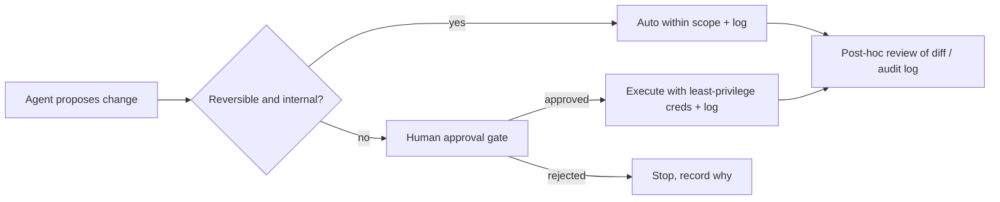

# M8.3 — Intellectual property, licensing, policy and accountability

| Status | Audience | Hours | Prerequisite |
|---|---|---|---|
| CORE · **cannot be exempted** | All clusters | 1 | M8.2 (verification) |

**Objective:** use Claude within the organisation's policy and the law, and **own the output you ship**.

> M8.2 taught you to check whether output is *correct*. This module is about whether you're *allowed*
> to use it, who owns it, and who answers for it. A correct deliverable can still breach a contract, a
> licence or a policy. "Claude wrote it" is never an answer to "who is accountable?"

> **Not legal advice.** This module tells you which questions to ask and which documents to check. Your
> legal team and your contracts answer them. Where the notes describe plan terms, read the current terms
> yourself. They change, and they differ between consumer and commercial plans.

---

## TL;DR

- **Ownership comes from contracts, not from the model.** Check three documents: your **plan's terms**
  (commercial or consumer), your **client contract** (IP assignment, AI clauses) and your **employment
  terms**. Whatever they say, the work product usually belongs to whoever the client contract says.
- **Inputs carry rights too.** Pasting copyrighted, licensed or confidential material doesn't change who
  owns it. Output that reproduces it can infringe. Treat brand names and logos as trademarks.
- **Every suggested dependency is a licence decision.** Permissive licences (MIT, BSD, Apache-2.0) are
  usually fine. **Copyleft** (GPL, AGPL; weak: LGPL, MPL) can impose obligations on your code. Check
  against the **organisation's approved licence list** before you merge.
- **Approved tools only.** A personal Claude account used on client work is **shadow AI**. It's a
  contract problem, not just a policy breach, because the client's data is governed by terms your
  organisation never agreed.
- **Disclose AI use** when policy or contract requires it, and in the form it requires.
- **One named, accountable human per output.** Design approval points into the workflow from the start.
  Never fully automate **hiring decisions, legal commitments, or production changes without review**.
- **Agents need a scope limit, a log and a stop button.** Review what an agent **actually changed** (the
  diff, the audit log), not what it **reported** changing.

---

## Concepts

### 1. Intellectual property for AI output

**Who owns prompts and outputs under your plan terms.** Three documents decide this, and you need all three:

| Document | What to look for | Where |
|---|---|---|
| **Anthropic plan terms** | Who owns inputs and outputs. Whether inputs can be used for training. Any IP indemnity | Commercial terms for Team, Enterprise and API. Consumer terms for Free, Pro, Max and Ultra |
| **Client contract / SOW** | IP assignment ("all deliverables vest in Client"), AI-tool clauses, confidentiality | Your account or legal team |
| **Your employment / contractor terms** | Work-for-hire, assignment of inventions | HR or legal |

The stable principle: the provider's terms decide what passes **between you and the provider**. The
client contract decides what passes **between your organisation and the client**. A favourable provider
term doesn't override a client clause that restricts AI tools. The specific wording of Anthropic's
current terms on output ownership and indemnity is **not reproduced here (unverified for this pack)**.
Read the current version for your plan type before you answer a client question about it.

**Client ownership clauses.** Most services contracts assign deliverables to the client. Ask two
questions:
- Does the contract **permit** AI tools at all, or only approved ones, or only with disclosure?
- Can you **assign** what you deliver? Copyright protection for purely machine-generated material is
  unsettled in many jurisdictions. Substantial human authorship (selection, arrangement, editing,
  original code) strengthens the position. If the client cares, that's a question for legal, not for you.

**Copyrighted material in inputs.** Uploading a document gives Claude no rights over it, and gives
*you* no new rights either. Analysing a licensed industry report for internal use may be fine.
Reproducing large chunks of it in a client deliverable may not be. Check the report's licence.
Paywalled content, a competitor's proprietary documentation, or a third party's source code under NDA
stays bound by its terms when you paste it into a prompt.

**Copyrighted material in outputs.** Claude is designed not to reproduce long copyrighted passages, but
you're still responsible for what you ship. Watch for:
- long verbatim-looking passages, song lyrics or book excerpts in marketing copy;
- code that looks lifted (distinctive comments, a licence header, odd variable names from a known
  project). Search for a distinctive line before you ship it;
- "in the style of" requests aimed at a living author or brand. Style isn't usually protected, but
  passing off and brand confusion can be.

**Trademark and brand use.** Product names, logos and slogans are trademarks. In generated decks, mock-ups
and copy:
- use a **client's** brand only under their brand guidelines and with their permission;
- don't imply endorsement by a third party ("Powered by AWS", a vendor logo on a slide) without the
  partner agreement that permits it;
- don't let a generated name for an internal tool collide with an existing trademark. Search before
  you adopt it.

### 2. Open-source and licensing in generated code

**Licence detection for suggested dependencies.** When Claude writes `npm install x` or `pip install y`,
it has made a licence decision for you. Before you merge, check for each new direct dependency:
1. that it **exists**. M8.2 covers hallucinated and typo-squatted package names;
2. its **licence**, from the registry metadata *and* the repository's LICENSE file (the two can disagree);
3. its **transitive** licences. A permissive package can pull in a copyleft one.

**Licence families: the stable facts**

| Family | Examples | Core obligation | Typical risk to proprietary code |
|---|---|---|---|
| **Permissive** | MIT, BSD-2/3-Clause, Apache-2.0, ISC | Keep the copyright and licence notice. Apache-2.0 adds a patent grant and a NOTICE file | Low. Mostly attribution |
| **Weak copyleft** | LGPL, MPL-2.0, EPL | Changes to the *licensed files or library* must be shared under the same licence. Linking from your code is generally allowed under conditions | Medium. Depends on how you link and modify |
| **Strong copyleft** | GPL-2.0, GPL-3.0 | If you **distribute** a combined work, the whole work must be offered under the GPL | High for distributed software |
| **Network copyleft** | AGPL-3.0 | Like GPL, but **offering the software over a network** counts as distribution | High for SaaS. It's the one people miss |
| **Non-open / source-available** | SSPL, BSL, "Commons Clause", no licence at all | Varies. **No licence means no permission** | Treat as blocked until legal clears it |

**Copyleft risk.** The question isn't "is GPL bad". It's "**will we distribute or network-serve a
combined work, and does the client contract forbid copyleft?**" Many client contracts do. Some
internal tooling can take GPL dependencies safely. A product you ship to a client usually can't without
a decision from legal.

**Attribution.** Permissive licences still require you to keep notices. Keep a `THIRD_PARTY_NOTICES` file
or an SBOM in the deliverable, and don't strip licence headers from copied files.

**The organisation's approved licence list.** It is **undefined in source**. The syllabus refers to it but
doesn't supply it. A typical shape:

```text
ALLOWED      MIT, BSD-2-Clause, BSD-3-Clause, Apache-2.0, ISC, 0BSD
REVIEW       LGPL-*, MPL-2.0, EPL-2.0, CC-BY-4.0 (docs only)
BLOCKED      GPL-*, AGPL-*, SSPL, BUSL, "UNLICENSED", missing licence
```

Get your organisation's real list from your legal or OSPO team. Don't guess at it.

### 3. The usage policy and the organisation's AI policy

**Prohibited uses.** Two layers apply:
- **Anthropic's Usage Policy** forbids certain uses on every plan (for example weapons development,
  malicious cyber activity, some kinds of surveillance and deception). Read the current version.
  This pack doesn't enumerate it.
- **Your organisation's AI policy** usually adds more: no client data on non-approved plans, no automated
  decisions about people, no use on certain regulated work. Its content is **undefined in source**.
  Insert yours.

**Disclosure rules for AI-assisted work.** Disclosure is usually required by one of:
- **contract** (a client's AI clause, or a public-sector bid rule);
- **policy** (your organisation's disclosure standard);
- **norm** (academic, journalistic, open-source project contribution rules. Some projects ban or
  restrict AI-generated contributions; read CONTRIBUTING.md).

Disclosure is proportional and factual: *what* AI did ("Claude drafted the first version of sections 2–4;
all figures were recomputed by the author"), not a blanket disclaimer on everything.

**Approved tools and plans.** "Claude" isn't one thing. A Free or personal Pro account and an
organisation's Enterprise seat have different data terms, admin controls, retention and audit. Policy
approves **specific plans and surfaces**, not the brand.

**Shadow AI and why a personal account on client work is a contract problem.** When you paste client
material into a personal account:
- the client's data is now processed under **consumer** terms your organisation never negotiated. That
  may breach the client's confidentiality clause and any data-processing agreement;
- your organisation has **no audit trail**, no retention control and no way to respond to a client's
  deletion request;
- if the client contract restricts AI tools to approved ones, it's a **breach of contract**, which
  goes well beyond a policy breach.

The fix isn't "be careful in your personal account". The fix is "**don't**". Ask for an approved seat.

### 4. Human approval and accountability

**A named accountable human for every output.** Write the name on the deliverable (the M8.2 verification
note). "The team" and "the AI" aren't owners. The named person:
- decided it was fit to send or merge;
- can explain how it was verified;
- answers questions about it later.

**Approval points designed into the workflow, not added after an incident.** Put a gate where an error
stops being cheap to reverse:

```text
draft ──► [verify: author] ──► internal review ──► [APPROVE: named owner] ──► external / prod
                                                         ▲
                              irreversible or external step: the gate goes here
```

Design question for any workflow: *at what step does a wrong output leave our control?* Put the human
gate there, and make it explicit (a checkbox, a PR approval, a signature). "Someone will probably look at
it" isn't a gate.

**What may never be fully automated:**

| Never fully automate | Why | What "with review" looks like |
|---|---|---|
| **Hiring decisions** | Consequential decisions about people. Bias risk. Regulated in many jurisdictions | Claude can summarise or structure. A human decides and records the reasons |
| **Legal commitments** | Contracts, signed statements, regulatory filings bind the organisation | Claude drafts. Legal or the authorised signatory approves |
| **Production changes without review** | Outages, data loss, security exposure | PR review, change approval, staged rollout |

### 5. Responsible AI in client work

**Bias checks on generated content.** Generated job ads, personas, test data, marketing copy and
summaries of people can encode stereotypes. Cheap checks:
- swap the demographic attribute and compare the output (gender, nationality, age);
- read personas and examples for who is always the engineer and who is always the assistant;
- for anything that ranks or scores people, see §4. A human decides.

**Accessibility.** Generated UI, documents and decks must still meet your accessibility standard: alt text,
contrast, heading structure, plain language. Claude can help audit (M3.6 covers WCAG review). It doesn't
make output accessible by default.

**Explaining AI use to a client.** Be specific and calm. Tell them which tools (approved, enterprise-grade
plan), for which tasks (drafting, code suggestions, analysis), what humans did (review, testing,
verification) and how their data is handled (the plan's data terms, no training on commercial data where
the terms say so; check current terms). Clients mainly want to hear about **control and accountability**,
not hype.

**Contractual restrictions on AI tools.** Typical clauses include: *no AI without prior written consent*;
*approved tools only*; *no client data in third-party AI services*; *disclosure in every deliverable*;
*client owns all prompts and outputs*. Find the clause **before** kick-off. Your team's Project
instructions and Skills must respect it (M3.3, M4.2).

### 6. Agentic-specific responsibilities

Agents (Claude Code, agentic sessions, automations) **act** rather than suggest. That changes what you're
accountable for.

- **Scope limits for autonomous actions.** Restrict them by permission mode, allowed tools, directories,
  credentials (read-only where possible), environments (sandbox before prod), and spend and time caps.
  Grant the minimum.
- **Logging.** Record what the agent ran, what it changed and with what credentials: transcripts, CI logs,
  audit logs, the Git history. If you can't reconstruct it, you can't defend it.
- **How to stop an agent.** Know the kill switch *before* you start. In Claude Code, interrupt the turn
  (Esc). For headless or CI runs, cancel the job. For a scheduled automation, disable it. Revoke the
  token if needed.
- **Reviewing what an agent actually changed, not what it reported.** An agent's summary ("all tests
  pass, I only touched `auth/`") is a **claim**. The evidence is the diff, the CI run, and the cloud audit
  log. A summary can be incomplete or wrong. Bash-driven edits, for example, may not be in the place you
  expect (M6.2 covers what checkpoints don't track).

---

## Under the hood

### Why "the model wrote it" doesn't move accountability

Accountability follows **decision rights**. The model has no decision rights: it can't sign, approve, be
employed or be sued. Every output reaches the world because a person **chose** to send, merge or publish
it. That choice is the accountable act. That's why the syllabus puts the named owner on the deliverable
(M8.2 §6) and why "cannot be exempted" applies here too.

### How copyleft "spreads": the mechanism

Copyleft licences grant permission to copy and modify **on condition** that derived works are licensed
the same way. The trigger is the licence's definition of the regulated act:
- **GPL:** *distribution* (conveying copies). Internal use with no distribution generally doesn't
  trigger source-sharing.
- **AGPL:** adds *interaction over a network*. Running modified AGPL code behind your SaaS API can
  oblige you to offer the source to users.
- **LGPL / MPL:** the obligation is scoped to the library or file, so you can use them from proprietary
  code under conditions (dynamic linking or replaceability for LGPL, file-level for MPL).

So the risk depends on **how you ship**, not only on what you import. That's why "is it allowed?" has
to be answered against your delivery model and your client contract.

### A minimal licence audit

The approach works in any stack: generate the dependency licence inventory, then diff it against the
approved list.

```python
# audit_licences.py: compare an SBOM-like inventory against the approved list.
# Input: a CSV of package,version,license produced by your stack's licence tool
# (for example a CycloneDX/SPDX SBOM export, or a licence-listing plugin for your package manager).
import csv, sys

ALLOWED = {"MIT", "BSD-2-Clause", "BSD-3-Clause", "Apache-2.0", "ISC", "0BSD"}
REVIEW_PREFIXES = ("LGPL", "MPL", "EPL")
BLOCKED_PREFIXES = ("GPL", "AGPL", "SSPL", "BUSL")

def classify(lic: str) -> str:
    lic = (lic or "").strip()
    if not lic or lic.upper() in {"UNKNOWN", "UNLICENSED", "NOASSERTION"}:
        return "BLOCKED (no licence)"
    if lic in ALLOWED:
        return "ALLOWED"
    if lic.startswith(BLOCKED_PREFIXES):
        return "BLOCKED"
    if lic.startswith(REVIEW_PREFIXES):
        return "REVIEW"
    return "REVIEW (unrecognised)"

with open(sys.argv[1], newline="") as f:
    for row in csv.DictReader(f):
        verdict = classify(row["license"])
        if verdict != "ALLOWED":
            print(f'{verdict:22} {row["package"]}=={row["version"]}  [{row["license"]}]')
```

Points to notice:
- **"No licence" is blocked.** Missing permission isn't permission.
- **Prefix matching is fragile.** It works here only because `"LGPL".startswith("GPL")` is false. A
  substring check (`"GPL" in lic`) would wrongly block LGPL. Test your classifier's edge cases.
- **Dual-licensed** expressions (`MIT OR GPL-2.0`) let you choose a licence, but your tool must parse the
  SPDX expression. Route anything with `OR`/`AND`/`WITH` to review.
- The audit reads metadata. When it matters, confirm the repository's actual LICENSE file.

Ask Claude to write the inventory step for your stack, then **verify the tool exists and its flags are
real** (M8.2). Package-manager licence plugins are a classic hallucination target.

### Where approval gates sit in agentic systems



The gate isn't "the agent asks permission when it feels unsure". The gate is **structural**: the agent
**can't** take the irreversible step without credentials or approval that only a human can grant.

---

## In production

**1. The client contract bans "third-party AI" and you're mid-project**
*Situation:* a developer finds the SOW clause "Supplier shall not use third-party AI services on Client
materials without written consent" three weeks after the team started using Claude.
*Right move:* stop using Claude on that client's material now. Tell the engagement lead and legal.
Get written consent (often obtainable, with a description of the plan's data terms) before you resume.
Record what was processed and where.
*Why:* it's a contract breach whatever the provider's terms say. Early disclosure limits the damage.
*Failure mode:* "it's an enterprise plan, so it's fine", and carrying on quietly.

**2. Claude suggests an AGPL library for a SaaS feature**
*Situation:* Claude proposes an excellent AGPL-3.0 PDF library for a multi-tenant SaaS product.
*Right move:* flag it in review as **blocked or review** under the approved list, and ask Claude for
permissively licensed alternatives with their licences. Verify each licence on the repository itself.
*Why:* network use triggers AGPL obligations, and the client contract likely forbids copyleft.
*Failure mode:* merging because "it's open source".

**3. A contractor uses their personal account on client logs**
*Situation:* a contractor pasted client production logs into their personal Pro account "because the
company seat was slow to provision".
*Right move:* treat it as a data incident under M8.1: report it, assess the scope, follow the client
contract's notification clause. Then fix the root cause, which is provisioning lag.
*Why:* consumer terms, no audit and no admin control. It's a contract problem.
*Failure mode:* deleting the chat and saying nothing.

**4. An automation that "sends the client their weekly report"**
*Situation:* a team wants Claude to compile the weekly report from Jira and email it to the client
automatically.
*Right move:* automate compilation, then **gate the send** behind a named approver. Include a verification note
and log every send.
*Why:* an external communication is the point where an error leaves your control.
*Failure mode:* a figure is wrong for three weeks running and nobody owned it.

**5. Agent reports "fixed the flaky test, touched only test files"**
*Right move:* read `git diff --stat` and the full diff. The diff shows a changed timeout in production
config as well.
*Why:* review the change, not the report.
*Failure mode:* approving based on the summary.

---

## Pitfalls

| Anti-pattern | Why it bites | Do instead |
|---|---|---|
| "Anthropic's terms say we own outputs, so the client is fine" | Provider terms don't override client contract restrictions | Check plan terms **and** the client contract **and** employment terms |
| Merging whatever `npm install` Claude suggested | Licence and supply-chain risk enter unseen | Existence check + licence check + approved-list gate in CI |
| Treating "no licence" as "free to use" | No licence means no permission | Block it until legal clears it |
| Personal account "just this once" on client work | Shadow AI is a contract breach and gives no audit | Approved seat only. Escalate provisioning delays |
| Blanket "AI may have been used" footer | Says nothing useful and may still breach a disclosure clause | Specific, proportional disclosure as policy requires |
| Owner = "the team" | Nobody answers for it | One named person on the verification note |
| Approval added after the first incident | The gate sits wherever the incident happened, not where risk is | Design gates at the irreversible or external step on day one |
| Trusting the agent's summary | Summaries omit and misstate | Review the diff, CI and audit logs |
| Agent with admin credentials "to avoid prompts" | Unbounded blast radius | Least privilege, sandbox first, known stop procedure |
| Generated persona and job-ad copy shipped unread | Encoded bias damages people and brand | Attribute-swap check, human review |

---

## Hands-on exercises

1. **Disclosure decisions.** For eight scenarios, decide whether and how AI use must be disclosed or
   restricted. Use: a public-sector bid, an open-source PR to a project with an AI policy, an internal
   design note, a client deliverable under a "no third-party AI" clause, marketing copy, a code change
   to a client repository, a hiring shortlist, and a regulatory response.
   **Done when:** each scenario has a decision (disclose / restrict / prohibit / none needed), the
   clause or policy line that drives it, and the exact disclosure wording where one is needed.
2. **Licence audit.** Audit a generated dependency list (with transitives) against the approved licence list.
   **Done when:** every dependency is classified ALLOWED, REVIEW or BLOCKED, each BLOCKED item has a
   verified permissive alternative or an escalation, and you've confirmed at least three licences
   against the repositories' LICENSE files.
3. **Approval design.** Design the approval points for a proposed automation (for example "Claude triages
   support tickets and replies to customers").
   **Done when:** the flow diagram marks every irreversible or external step, each gate has a named role,
   the stop procedure and logging are specified, and you've justified each gate in one sentence.
4. **Policy quiz.** Take the scenario-based policy quiz (`quiz.html#m8-3`). It counts toward the governance assessment.
   **Done when:** you score ≥ 8/10 and can explain every miss.

---

## Advanced preview

- **M8.5 AI regulation and client compliance.** Moves from organisation policy to regulation: risk
  classification of AI uses, sector rules, and translating client compliance requirements into controls.
- **M5.4 Review and secure coding.** The full process for reviewing generated code, including dependency
  and supply-chain checks that go beyond licences.
- **M6.4 the .claude folder and hooks / M6.6 automation at scale.** How scope limits, permission policy
  and logging get enforced in configuration rather than by individual discipline.

**Competency C8 (Practitioner):** follows policy unsupervised and can explain ownership and
accountability for any AI-assisted deliverable.

➡ **Check yourself:** [`quiz.html#m8-3`](../assessments/quiz.html#m8-3)
