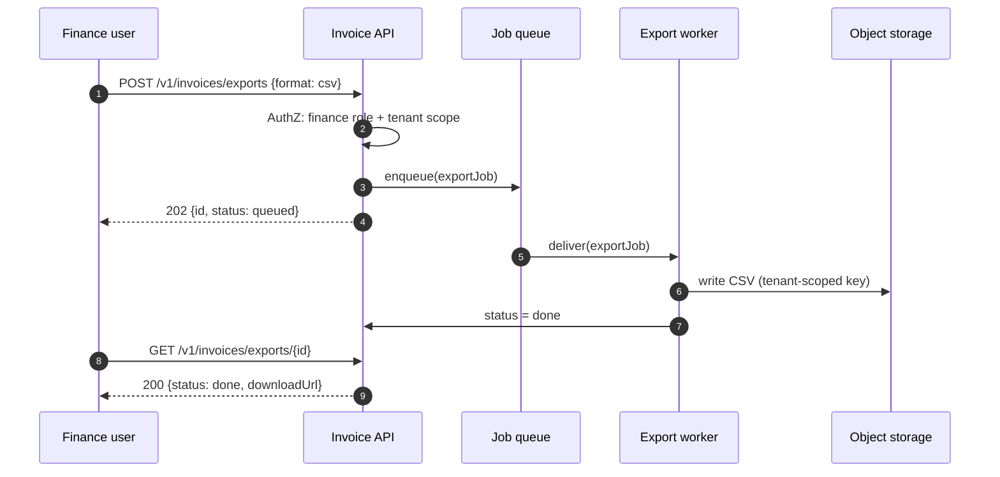

# M5.1 — From requirements to design

| Status | Audience | Hours | Prerequisite |
|---|---|---|---|
| ELECTIVE | Clusters A, B, C, D, E; business analysts in G | 2 | D2 (prompt and context engineering) and M3.3 |

**Prerequisite note:** "D2" is the domain M2.1–M2.4. You have M2.1 (Level 1) and M2.2/M2.3 (this level).
**M2.4 is an Advanced module**, so this is a forward reference in the source. Nothing here depends on it.

**Objective:** turn raw requirements into **testable specifications** and **reviewed designs**.

> Requirements arrive as email threads, call notes and 80-page RFPs. Claude is very good at pulling
> structure out of mess, and it's just as good at inventing structure that wasn't there. The job in
> this module is to get the extraction **and** keep every artefact traceable to what someone actually said.

---

## TL;DR

- **Extract, then trace.** Pull functional requirements, non-functional requirements, constraints and open questions from the
  source, with a **quote or reference per item**. Anything without a source is an assumption. Label it.
- **The question list is a deliverable.** Gaps and ambiguities go back to the client as numbered questions,
  each with the decision it blocks.
- **Stories pass INVEST; criteria are Given-When-Then; edge cases are enumerated deliberately** (empty, max,
  concurrent, unauthorised, failure of a dependency).
- **Contracts come from stories,** then get reviewed for consistency, naming and versioning. Claude drafts the
  OpenAPI. A human decides the conventions.
- **ADRs record the options, the trade-offs, the decision and the consequences.** Claude drafts and humans decide.
  Check every factual claim in an ADR (M8.2).
- **Review designs against real constraints:** security, scale, cost, team skill.
- **Estimates are assumption-tagged and owned by a named human.** Never ship a Claude estimate as-is.
- **Diagrams as code** (Mermaid or PlantUML) so they can be diffed, reviewed and iterated in conversation.

---

## Concepts

### 1. Requirement understanding

**Extracting functional and non-functional requirements from emails, call notes and RFPs.** Ask for a
table, not prose, and require a source for every row:

```text
<source_thread> …client emails, redacted (M8.1)… </source_thread>
<call_notes> … </call_notes>

Extract requirements into a table:
ID | Type (FR / NFR / Constraint) | Statement (one testable sentence) | Source (doc + quote ≤ 20 words) | Confidence
Rules:
- Only statements supported by a quote. If you infer something, put it under "Assumptions" instead.
- NFRs: performance, availability, security, compliance, accessibility, data residency, supportability.
- Do not merge two requirements into one row.
```

- **Functional requirements** say what the system does ("the user can export invoices as CSV").
- **Non-functional requirements** say how well it does it, or under what constraints ("export of 100k rows in < 30 s",
  "data stays in the EU"). Clients rarely state NFRs. Their absence is a gap, not a "none".
- **Constraints** are fixed by context ("must run on the client's Azure tenant", "go-live before the
  March audit").

**Gap and ambiguity lists, and the question list you send back to the client.** Ask Claude to find:
- **ambiguities** ("users" means which roles?, "real-time" means what latency?);
- **contradictions** between sources (the email says SSO only, the call notes say email login too);
- **missing areas** (no word on audit logging, data retention or error handling).

Turn them into a client-ready question list:

| # | Question | Why we ask (decision it blocks) | Our default if unanswered |
|---|---|---|---|
| Q1 | Does "real-time" mean under 1 s or under 1 min? | Push vs polling architecture | Polling every 60 s |

The "default if unanswered" column turns a stalled question into a visible, reversible assumption.

### 2. User stories and acceptance criteria

**INVEST stories.** Each story should be:

| Letter | Means | Claude's typical miss |
|---|---|---|
| **I**ndependent | Can be built and released alone | Chains of stories that only work together |
| **N**egotiable | States the need, not the implementation | Stories that prescribe tables and endpoints |
| **V**aluable | Delivers value to a named user | "As a system, I want…" |
| **E**stimable | The team can size it | Vague scope ("handle all exports") |
| **S**mall | Fits in a sprint | Epics disguised as stories |
| **T**estable | Has checkable acceptance criteria | "Should be fast" |

Ask Claude to **score its own stories against INVEST** and split any that fail. That's the M2.2
self-critique pattern applied.

**Given-When-Then criteria.**

```gherkin
Scenario: Export is limited to the user's own tenant
  Given a finance user in tenant "acme" with 3 invoices
    And tenant "globex" has 5 invoices
  When the user exports invoices as CSV
  Then the file contains exactly 3 rows
    And no row references tenant "globex"
```

**Edge-case enumeration.** Prompt for it explicitly, by category. Claude's default criteria cover the happy path:
empty input · maximum size · boundary values · concurrent edits · permissions (unauthorised, wrong
tenant) · dependency failure (timeout, partial response) · time (time zones, DST, month end) ·
internationalisation · retries and idempotency.

**Traceability back to the source requirement.** Every story carries the requirement IDs it satisfies
(`Implements: FR-07, NFR-03`), and every requirement maps to at least one story. Ask Claude for the
**reverse check**: "list requirements with no story, and stories with no requirement". Orphans are scope
creep or gaps.

### 3. API and data contracts

**Drafting OpenAPI or GraphQL schemas from stories.** Supply the stories, your naming conventions and an existing spec
from your codebase as the style reference (M5.2).

```yaml
openapi: 3.1.0
info: { title: Invoice Export API, version: 1.0.0 }
paths:
  /v1/invoices/exports:
    post:
      operationId: createInvoiceExport
      summary: Start an asynchronous CSV export of the caller's invoices   # FR-07
      requestBody:
        required: true
        content:
          application/json:
            schema: { $ref: '#/components/schemas/ExportRequest' }
      responses:
        '202':
          description: Export accepted
          content:
            application/json:
              schema: { $ref: '#/components/schemas/ExportJob' }
        '403': { description: Caller lacks finance role }
components:
  schemas:
    ExportRequest:
      type: object
      required: [format]
      properties:
        format: { type: string, enum: [csv] }
        from:   { type: string, format: date }
        to:     { type: string, format: date }
    ExportJob:
      type: object
      required: [id, status]
      properties:
        id:     { type: string }
        status: { type: string, enum: [queued, running, done, failed] }
```

The same story as a **GraphQL** schema (SDL):

```graphql
type Mutation {
  "Starts an async import; poll importJob for status."
  startImport(fileId: ID!): ImportJob!
}
type Query { importJob(id: ID!): ImportJob }
type ImportJob {
  id: ID!
  status: ImportStatus!
  rowCount: Int @deprecated(reason: "Use rowsProcessed")
  rowsProcessed: Int
}
enum ImportStatus { QUEUED RUNNING DONE FAILED }
```

Note the 202 plus job resource in the OpenAPI version, and the job type in the GraphQL one. The NFR "100k rows in < 30 s" pushed the design to asynchronous. Ask Claude to **say
which requirement drove each design choice**.

**Contract review for consistency and naming.** Ask for a review against your rules: plural nouns,
casing (`camelCase` vs `snake_case`), consistent error shape, pagination style, ID formats, date formats.
Claude is good at spotting inconsistency across a 40-endpoint spec. It doesn't know your conventions unless
you give them.

**Versioning rules.** Decide and write down:
- what counts as **breaking**: removing or renaming a field, tightening validation, changing types or
  semantics;
- what's **additive**: new optional fields and new endpoints;
- the mechanism: URL (`/v1/`), header or schema version, and the deprecation window. **GraphQL** usually
  doesn't version the URL. The schema evolves additively, old fields are marked `@deprecated(reason: …)`, and
  removal waits until usage monitoring shows no clients left.

Then have Claude classify each proposed change as breaking or additive. Verify the classification. That's a
judgement with real consequences.

### 4. Design documents and ADRs

**Options analysis with trade-offs.** Ask for 2–4 real options, including "do nothing" or "the boring option",
scored against **your** criteria with the reasoning shown. This is the M3.4 weighted-criteria pattern.

**The Architecture Decision Record format** (the Nygard shape):

```markdown
# ADR-0012: Use a managed message queue for invoice export jobs

Status: Proposed            <!-- Proposed | Accepted | Superseded by ADR-00NN | Deprecated -->
Date: YYYY-MM-DD
Deciders: <named humans>

## Context
Exports of up to 100k rows must complete in < 30 s (NFR-03) without blocking API workers.
The team runs on <cloud>; no one on the team has operated <broker X> in production.

## Options considered
1. Managed queue service (cloud-native)  – trade-offs: …
2. Self-hosted broker                    – trade-offs: …
3. Database-backed job table             – trade-offs: …

## Decision
Option 1, because …

## Consequences
+ …   − …   Follow-ups: …
```

**Reviewing a design against its real constraints:**

| Constraint | Question to put to the design (and to Claude) |
|---|---|
| **Security** | Authentication, authorisation, tenant isolation, secrets, data classification. What's the abuse case? |
| **Scale** | Expected and peak load, data growth, what breaks first at 10× |
| **Cost** | Run cost at expected volume, cost cliffs, licence costs |
| **Team skill** | Can *this* team build, operate and debug it at 3 a.m.? |

Claude tends to over-weight the technically elegant option and under-weight team skill and
operating cost. **Tell it about the team.**

**Note:** ADR **authoring** lives here. Where ADRs are **stored and committed** (`docs/adr/`, numbering,
superseding) is **M6.8**.

**Verify every factual claim in an ADR.** "Service X supports exactly-once delivery" and "Y's free tier
allows N messages" are the volatile, high-risk claims M8.2 warns about. Check each one against vendor docs
and cite the source in the ADR.

### 5. Estimation support

**Work breakdown.** Ask Claude to break stories into tasks with explicit dependencies (sequential vs
parallel, as in M2.2). It's good at remembering forgotten work: migrations, feature flags, documentation,
observability, load testing, rollback plans.

**Assumption-tagged estimates.**

| Task | Estimate (days, range) | Assumptions | Risk if wrong |
|---|---|---|---|
| CSV export endpoint | 2–3 | A1: existing auth middleware covers finance role | +2 days if new role model needed |

**Risk lists.** Ask for risks with likelihood, impact, an early warning sign and a mitigation, then prune
the generic ones. "Scope creep" with no specifics is noise.

**Never shipping an estimate without a human owner.** Claude has no knowledge of your team's velocity,
on-call load, holidays or codebase quirks, and it carries no accountability (M8.3). The estimate that
goes to a client or a plan has a **named owner** who has reviewed the assumptions and agrees to them.

### 6. Diagrams from text

**Sequence, component and data-flow diagrams as Mermaid or PlantUML.** Text-based diagrams can be
reviewed in a PR, diffed, and regenerated when the design changes. Ask Claude for Mermaid (it renders on
GitHub and GitLab and in many docs tools) or PlantUML (more layout control).



**Iterating them in conversation.** Make specific edits ("add the failure path when the worker times out",
"mark the trust boundary", "show the retry with backoff"). Render after each change. Claude sometimes
produces syntax that doesn't render, so paste the error back. Check that the diagram still matches the
ADR and the OpenAPI. The three artefacts must agree.

---

## Under the hood

### Why extraction needs quotes

Summarisation is **generative**. The model writes a plausible statement *consistent with* the source, and a
plausible requirement is easy to produce even when the source never said it. "The system must support
SSO" might be paraphrase or invention. Requiring a **verbatim quote per row** changes the task from
generation to retrieval-plus-labelling, and gives you a cheap check: search the source for the quote (M2.3
grounding, M8.2 verification). Rows whose quote doesn't exist are fabrications.

### The traceability chain

```text
Source (email/RFP quote) ──► Requirement (FR/NFR id) ──► Story (+ GWT criteria) ──► Contract (operationId)
                                                                          │
                                                                          └──► Test (M5.5) ──► Code
ADR (decision) ◄── driven by NFRs/constraints
```

Each arrow is a reference you can check. When a change request arrives, walk the chain forward to find
everything affected (the M3.3 "impact of a change request", at engineering depth).

### Why Claude over-designs

Training data over-represents published architectures: conference talks, big-tech blogs and
reference designs. Without constraints, Claude drifts toward microservices, event sourcing and
Kubernetes. Feed it the **real** constraints (team size, skill, budget, load) and ask "what is the simplest
design that meets these NFRs?" That reverses the bias.

### Chaining the artefacts (M2.2)

Run it as a chain with review gates, not one mega-prompt:

1. Extract requirements + questions → **you review and send the questions**
2. Stories + GWT from the approved requirements → **review against INVEST**
3. Contract from the stories → **review against conventions**
4. ADR options → **humans decide**
5. Diagrams + estimate → **named owner signs off**

Each step's output is the next step's input, and each gate is where a human error check is cheapest.
Once the chain is stable, it's a candidate for a Project (M3.3) or a Skill (M4.2).

---

## In production

**1. Pre-sales: an RFP section due tomorrow**
*Situation:* a 60-page RFP, and you own the "technical approach" section.
*Right move:* extract the RFP's mandatory requirements with page references and build a compliance matrix
(requirement → our response → evidence). Draft only against the matrix. List the questions to submit
in the RFP clarification window.
*Why:* evaluators score against their own requirement list, and traceability is the scoring sheet.
*Failure mode:* a fluent section that never answers requirement 4.3.2.

**2. Sprint refinement from a messy thread**
*Situation:* the product owner forwards a 30-message thread: "can we get this into next sprint?"
*Right move:* extract FR/NFR with quotes → stories with GWT → ambiguity list. Take the ambiguity list
to refinement, not the stories.
*Failure mode:* stories that bake in one person's guess about "real-time".

**3. A contract shared by two stacks**
*Situation:* a .NET backend and a TypeScript frontend team disagree on field casing and error shapes.
*Right move:* make one OpenAPI file the source of truth. Have Claude review it against the agreed
convention, and generate clients from it. Record the convention as an ADR.
*Failure mode:* each team asks Claude for "the API" separately and gets two dialects.

**4. A queueing decision under deadline**
*Situation:* the architect asks for an ADR comparing two queueing options by Friday.
*Right move:* Claude drafts options and trade-offs. You verify every vendor claim (delivery guarantees,
limits, pricing) against official docs and cite it. The team decides in review. The ADR records the
deciders by name.
*Failure mode:* an ADR that asserts a limit or guarantee nobody checked, and a production design built on it.

**5. An estimate requested "just roughly" by sales**
*Right move:* produce a range with assumptions and risks, and name the tech lead who reviewed it. Mark it
"indicative, subject to discovery".
*Failure mode:* a single number from a chat ends up in a fixed-price contract.

---

## Pitfalls

| Anti-pattern | Why it bites | Do instead |
|---|---|---|
| "Summarise the requirements" | Plausible invented requirements, no trace | Table with a quote per row. Assumptions listed separately |
| Treating NFR silence as "none" | Performance, security and residency discovered late | Prompt for each NFR category and put gaps in the question list |
| Stories that specify the database schema | Not negotiable, couples design early | State the need. Design comes later |
| Happy-path-only acceptance criteria | Defects found in UAT or prod | Enumerate edge cases by category |
| Asking for "the API" with no conventions | Inconsistent naming across teams | Supply conventions and a reference spec |
| Letting Claude pick the architecture | Over-designed, ignores team skill and cost | Supply the real constraints. Humans decide in an ADR |
| Unverified facts in an ADR | Decisions built on false premises | Verify and cite every factual claim |
| A single-number estimate | Hidden assumptions become commitments | Ranges, assumptions, risks, a named owner |
| Diagrams as images | Can't diff, drift from the design | Mermaid or PlantUML in the repo, updated with the ADR and contract |

---

## Hands-on exercises

1. **Thread to stories.** From a real client email thread (redacted), produce stories, acceptance criteria and a question list.
   Peer review.
   **Done when:** every story traces to a quoted source, every story passes INVEST, each has GWT criteria with at
   least three edge cases, the question list has a "decision it blocks" for each item, and a peer found
   no untraceable requirement.
2. **Two conventions, one contract.** Draft an OpenAPI contract for one story in two stacks' conventions (for example
   ASP.NET and NestJS) and reconcile the naming.
   **Done when:** you have one reconciled spec that validates in an OpenAPI linter, plus a short naming decision
   recorded as an ADR.
3. **Queueing ADR.** Write an ADR choosing between two queueing options, verifying every factual claim.
   **Done when:** the ADR has context, options, decision, consequences and status. Every factual
   claim has a cited official source, and the deciders are named.
4. **Auth sequence diagram.** Produce a sequence diagram for an authentication flow and iterate it three times.
   **Done when:** the final Mermaid renders, includes the failure and token-refresh paths and the trust
   boundary, and a reviewer confirms it matches the implemented or specified flow.

---

## Advanced preview

- **M5.4 Review and secure coding.** Reviewing what gets built from these specs: secure-coding checks,
  dependency review, and the verification checklist M8.2 points to.
- **M5.6 Data and system design.** Deeper data modelling, system design trade-offs and capacity
  reasoning beyond the ADR level here.
- **M6.8 (this level) and M6.4 (Advanced).** Where ADRs, specs and plans live in the repository, and how
  rules and hooks keep them current.

**Competency C5 (Practitioner):** produces specification artefacts a reviewer accepts with minor edits,
with every assumption stated.

➡ **Check yourself:** [`quiz.html#m5-1`](../assessments/quiz.html#m5-1)
